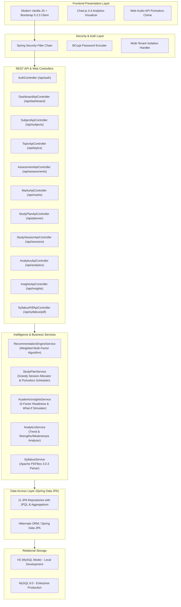
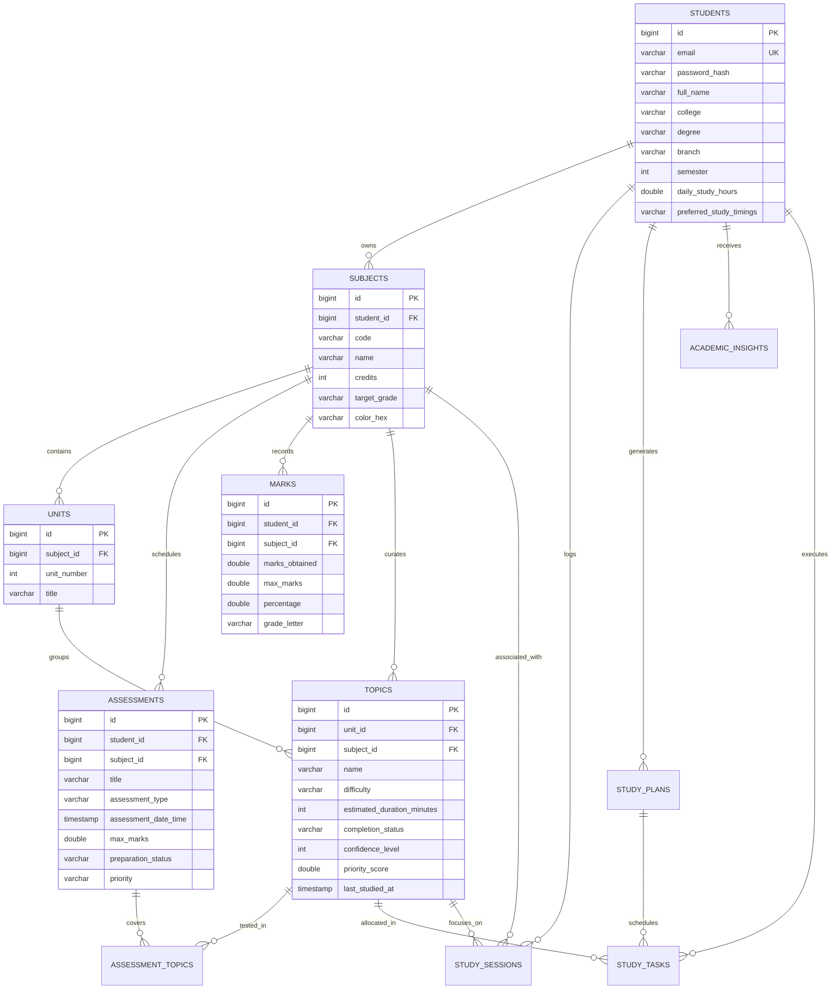

# 🎓 Syllabix — Intelligent Student Management & Adaptive Academic Planning Platform

[](https://www.oracle.com/java/)
[](https://spring.io/projects/spring-boot)
[](https://spring.io/projects/spring-security)
[](https://www.mysql.com/)
[](https://getbootstrap.com/)
[](https://www.chartjs.org/)

---

## 📌 Executive Summary

**Syllabix** is an intelligent, full-stack academic companion and adaptive planning platform designed to transform how college and university students navigate their semester workloads. Rather than acting as another passive CRUD tracker, Syllabix actively solves three fundamental student dilemmas:

1. **What should I study?** — Solved via an adaptive weighted multi-factor recommendation engine.
2. **When should I study it?** — Solved via an automated daily and weekly timetable generator that respects declared daily study budgets and breaks.
3. **Which topics require the most attention?** — Solved via continuous academic health analytics, 5-factor exam readiness scoring, and proactive risk detection.

The platform is built with a strictly typed Java 21 backend, Spring Boot 3.3.5, Spring Data JPA / Hibernate, Spring Security with BCrypt hashing, and dual-mode relational database support (Zero-setup embedded H2 MySQL mode + Production MySQL 8.0).

---

## 🏛️ System Architecture



---

## 🗄️ Relational Database Schema & Entity Relationships

The schema guarantees strict **Third Normal Form (3NF)** with explicit foreign keys, cascading deletes, unique constraints, and optimized composite indexes for multi-tenant querying.



---

## 🧠 The Intelligent Recommendation Engine (Deep Dive)

The core innovation of Syllabix is its **Weighted Multi-Factor Prioritization Engine** (`RecommendationEngineService.java`). It synthesizes four dynamic variables across subjects and topics into a unified 0–100 priority score with mathematical rigor:

$$Priority = (W_{urgency} \times F_{urgency}) + (W_{incompletion} \times F_{incompletion}) + (W_{difficulty} \times F_{difficulty}) + (W_{weakness} \times F_{weakness})$$

Where weights default to:
- **$W_{urgency} = 0.35$ (35%):** Exam Urgency
- **$W_{incompletion} = 0.30$ (30%):** Syllabus Incompletion
- **$W_{difficulty} = 0.20$ (20%):** Topic Difficulty & Student Confidence
- **$W_{weakness} = 0.15$ (15%):** Academic Weakness / Past Marks Gap

The weights are student-configurable via slider controls in the Planner UI and are dynamically normalized to sum to $1.0$:

$$W_i' = \frac{W_i}{\sum_{j=1}^4 W_j}$$

### Factor Normalization Rules

1. **Exam Urgency Factor ($F_{urgency} \in [10, 100]$):**
   - $\le 2\text{ days until exam} \implies 100.0$
   - $\le 5\text{ days until exam} \implies 85.0$
   - $\le 10\text{ days until exam} \implies 65.0$
   - $\le 20\text{ days until exam} \implies 40.0$
   - $> 20\text{ days or no upcoming exam} \implies 10.0$ (maintenance baseline)

2. **Syllabus Incompletion Factor ($F_{incompletion} \in [0, 100]$):**
   $$F_{incompletion} = 100.0 - \left( \frac{\text{Completed Topics}}{\text{Total Topics}} \times 100 \right)$$

3. **Topic Difficulty & Confidence Factor ($F_{difficulty} \in [10, 100]$):**
   - Base difficulty: $\text{EASY} = 30.0$, $\text{MEDIUM} = 60.0$, $\text{HARD} = 90.0$.
   - Confidence adjustment (where confidence $C \in [1, 5]$):
     $$F_{difficulty} = \text{clamp}_{10}^{100}\left( \text{Base} + (3 - C) \times 10.0 \right)$$
   *(e.g., A HARD topic with confidence level 1 yields $90 + 20 = 110 \to 100.0$; confidence level 5 reduces to $90 - 20 = 70.0$).*

4. **Academic Weakness Factor ($F_{weakness} \in [0, 100]$):**
   - If historical marks exist for the subject:
     $$F_{weakness} = \text{clamp}_0^{100}\left( 100.0 - \text{Average Marks \%} \right)$$
   - If no marks recorded yet, defaults safely to $50.0$.

### Priority Classification & Explainable Rationale
- **$\ge 70.0 \implies \text{CRITICAL}$** (Red indicator)
- **$\ge 50.0 \implies \text{HIGH}$** (Amber indicator)
- **$\ge 30.0 \implies \text{MEDIUM}$** (Blue indicator)
- **$< 30.0 \implies \text{LOW}$** (Green indicator)

Every recommendation emits a human-readable explanation explaining **why** the topic was elevated (e.g., *"Database Systems has DBMS MST in 5 days. 60% of syllabus is still pending. Categorized as Hard topic requiring deeper focus (low confidence level). Subject average is currently 60.0%; extra practice recommended."*).

---

## 🌟 Unique Differentiating Features (Why Syllabix Outperforms Standard LMS)

Standard university LMS platforms (like Moodle / Thapar LMS) are **passive document repositories**: they dump lecture PDFs, raw text announcements, and bare submission links without answering: *What should I study right now? How many marks do I need on my MST to keep an A grade? Which lab assignment deadline is approaching?*

Syllabix directly addresses these pain points with 8 transformative differentiators:

### 1. 🏛️ Thapar LMS Course Evaluation Scheme Parser & Target Run-Rate Calculator
- **The Problem in Moodle/LMS:** Professors paste plain text announcements on course pages:
  `LAB Evaluation: 20 Marks, Sessional Quiz: 10 Marks, MST: 30 Marks, EST: 40 Marks`.
  Traditional LMS does nothing with this.
- **The Syllabix Innovation:** Students paste that exact raw text into Syllabix:
  - Java regex automatically extracts the evaluation components, weights, and dates.
  - Automatically schedules them as real trackable calendar assessments.
  - Calculates the **Target Run-Rate**: *"You have scored 18/20 in Lab and 8.5/10 in Quiz. To secure an A Grade (80%), you need 53.5 / 70 marks (76.4% run-rate) across upcoming MST (30M) and EST (40M). Scoring 23/30 in MST and 30/40 in EST comfortably secures your A grade."*

### 2. 🧪 Thapar Lab Assignments 1–8 Real-Time Tracker
- Tracks all semester lab submissions (Assignment 1 through Assignment 8) with submission status checkmarks, countdown timers, and integrated timetable reminders so students never lose internal evaluation marks.

### 3. 🎯 "What Should I Study Today?" (The Anti-Procrastination Hero Card)
- Dumps of 50 lecture slides cause decision paralysis. Syllabix evaluates proximity to MST/EST, syllabus incompletion, topic difficulty, and past quiz marks to present the **top three topics to study right now** with a 1-click Pomodoro focus session launcher.

### 4. 🛡️ 5-Factor Exam Readiness Score
- Computes an objective readiness percentage (0–100%) and letter grade (A+ through F) before exams:
  $$\text{Readiness} = (0.35 \times \text{Syllabus}) + (0.25 \times \text{Marks}) + (0.15 \times \text{Confidence}) + (0.15 \times \text{HardTopicsCoverage}) + (0.10 \times \text{TimeBuffer})$$

### 5. 🔮 "What-If" Academic Scenario & CGPA Simulator
- Interactive sandbox to simulate hypothetical exam scores: *"What if I score 27/30 in DBMS MST and 35/40 in EST? What will my semester SGPA and overall CGPA be?"*

### 6. 🧠 Spaced-Repetition Active Recall & Memory Decay Radar
- Implements Ebbinghaus memory decay intervals (1d, 3d, 7d, 14d, 30d). Automatically alerts students when topics studied in Week 1-6 are decaying from retention before the MST or EST exam.

### 7. 📄 Intelligent PDF Syllabus & Slide Extractor (Apache PDFBox)
- Drag and drop lecture slides or syllabus PDFs. Apache PDFBox extracts units, chapters, and topics into an editable review table.

### 8. ⏱️ Pomodoro Focus Timer with Web Audio Chime & Study Streak Tracker
- Tracks active study minutes per topic and subject with mandatory completion verification and anti-burnout pacing.

---

## 🚀 Getting Started

### Prerequisites
- **Java Development Kit (JDK) 21** or later (JDK 21, 22, 23, 24, 25, 26 fully compatible).
- Git.
- Optional: MySQL 8.0+ (Only required for standalone MySQL production deployment).

### Option A: Instant Out-of-the-Box Execution (Embedded H2 MySQL Mode)
Syllabix comes pre-configured with file-persistent H2 operating in MySQL compatibility mode (`MODE=MySQL`). No database installation or manual configuration is required.

1. **Clone the repository:**
   ```bash
   git clone https://github.com/syllabix/syllabix-platform.git
   cd java_project
   ```

2. **Run using the included Maven wrapper:**
   ```bash
   .\mvn.cmd spring-boot:run
   ```
   *(On Linux/macOS: `./mvnw spring-boot:run`)*

3. **Access the application:**
   - **Web UI:** [http://localhost:8080](http://localhost:8080)
   - **Preloaded Demo Student Account:**
     - **Email:** `alex@university.edu`
     - **Password:** `password123`
     *(You can also click "Use Demo Student Account" on the login screen to auto-fill).*
   - **H2 Web Console:** [http://localhost:8080/h2-console](http://localhost:8080/h2-console)
     - JDBC URL: `jdbc:h2:file:./data/syllabix_db;MODE=MySQL;NON_KEYWORDS=USER`
     - User: `sa` | Password: *(blank)*

---

### Option B: Production MySQL 8.0 Deployment

1. **Create the MySQL Database:**
   ```sql
   CREATE DATABASE syllabix_db CHARACTER SET utf8mb4 COLLATE utf8mb4_unicode_ci;
   CREATE USER 'syllabix_user'@'localhost' IDENTIFIED BY 'SyllabixPass@2026';
   GRANT ALL PRIVILEGES ON syllabix_db.* TO 'syllabix_user'@'localhost';
   FLUSH PRIVILEGES;
   ```

2. **Execute the Relational Schema:**
   ```bash
   mysql -u syllabix_user -p syllabix_db < src/main/resources/schema.sql
   ```

3. **Start Syllabix with the MySQL Profile:**
   ```bash
   .\mvn.cmd spring-boot:run -Dspring-boot.run.profiles=mysql
   ```

---

## 🧪 Automated Testing & Verification

The test suite validates the core recommendation calculations, multi-factor weighting, exam countdown bounds, timetable daily budget enforcement, marks grading math, and scenario simulation.

Run the test suite with:
```bash
.\mvn.cmd test
```

### Verified Test Suite Breakdown
| Test Class | Scope Tested | Status |
|:---|:---|:---:|
| `RecommendationEngineServiceTest` | 35/30/20/15 priority formula, 5-day exam urgency, empty syllabus edge case | **PASSED** (3/3) |
| `StudyPlanServiceTest` | Daily study hours budget enforcement, multi-day task allocation | **PASSED** (1/1) |
| `MarksServiceTest` | Percentage calculation, 10-point CGPA conversion, letter grade boundaries | **PASSED** (2/2) |
| `AcademicInsightsServiceTest` | 5-factor exam readiness composite, What-If simulation delta | **PASSED** (2/2) |
| `SubjectServiceTest` | Duplicate subject code collision detection, syllabus completion math | **PASSED** (2/2) |
| **Total** | **All Core Business Logic & Algorithms Verified** | **10 / 10 PASSED** |

---

## 📡 REST API Reference

All protected endpoints enforce multi-tenant isolation via the authenticated student session.

### 1. Authentication (`/api/auth`)
| Method | Endpoint | Description |
|:---|:---|:---|
| `POST` | `/api/auth/register` | Register a new student profile |
| `POST` | `/api/auth/login` | Authenticate student and establish session |
| `POST` | `/api/auth/logout` | Invalidate current session |
| `GET` | `/api/auth/profile` | Retrieve student profile and availability settings |
| `PUT` | `/api/auth/profile` | Update study hours, preferred timings, and goals |
| `POST` | `/api/auth/reset-password` | Secure password reset workflow |

### 2. Dashboard (`/api/dashboard`)
| Method | Endpoint | Description |
|:---|:---|:---|
| `GET` | `/api/dashboard/stats` | Aggregated metrics (total subjects, syllabus %, upcoming exams, study streak) |

### 3. Subjects & Syllabus (`/api/subjects`, `/api/topics`, `/api/syllabus`)
| Method | Endpoint | Description |
|:---|:---|:---|
| `GET` | `/api/subjects` | List all enrolled subjects with syllabus progress |
| `POST` | `/api/subjects` | Add a new academic subject |
| `PUT` | `/api/subjects/{id}` | Edit subject metadata, credits, or target grade |
| `DELETE` | `/api/subjects/{id}` | Delete subject and cascading child entities |
| `GET` | `/api/topics/subject/{id}` | Retrieve syllabus units and topic tree |
| `POST` | `/api/topics` | Create new topic under a unit |
| `PATCH` | `/api/topics/{id}/status` | Toggle completion status (`NOT_STARTED`, `IN_PROGRESS`, `COMPLETED`) |
| `POST` | `/api/syllabus/pdf/extract` | Upload syllabus PDF & extract structured topics via Apache PDFBox |

### 4. Assessments & Calendar (`/api/assessments`)
| Method | Endpoint | Description |
|:---|:---|:---|
| `GET` | `/api/assessments` | List all upcoming and past assessments |
| `GET` | `/api/assessments/calendar` | Calendar events bounded by date range (`start` and `end`) |
| `POST` | `/api/assessments` | Schedule a Quiz, MST, EST, Assignment, or Lab |
| `DELETE` | `/api/assessments/{id}` | Remove scheduled assessment |

### 5. Marks & Analytics (`/api/marks`, `/api/analytics`)
| Method | Endpoint | Description |
|:---|:---|:---|
| `GET` | `/api/marks` | List all recorded marks records |
| `POST` | `/api/marks` | Log marks obtained for an assessment |
| `GET` | `/api/analytics/charts` | Chart.js dataset (Subject bar, Trend line, Syllabus donut, Weekly hours) |

### 6. Intelligent Recommendations & Planner (`/api/planner`)
| Method | Endpoint | Description |
|:---|:---|:---|
| `GET` | `/api/planner/recommendations` | Calculate ranked topic recommendations with rationales |
| `GET` | `/api/planner/today` | "What Should I Study Today?" top 3 prioritized topics |
| `POST` | `/api/planner/generate` | Generate automated study timetable within daily hours limit |
| `PATCH` | `/api/planner/tasks/{id}/toggle` | Mark study task as completed |
| `POST` | `/api/planner/tasks/{id}/reschedule` | Reschedule missed study task to a new date |

### 7. Study Sessions & Pomodoro (`/api/sessions`)
| Method | Endpoint | Description |
|:---|:---|:---|
| `GET` | `/api/sessions` | Retrieve study session logs and current streak |
| `POST` | `/api/sessions` | Confirm and record a completed study session |

### 8. Academic Insights & Simulations (`/api/insights`)
| Method | Endpoint | Description |
|:---|:---|:---|
| `GET` | `/api/insights/readiness` | 5-Factor exam readiness score for all upcoming tests |
| `POST` | `/api/insights/simulate` | Execute "What-If" academic simulation |
| `GET` | `/api/insights/revision` | Spaced-repetition active recall topic recommendations |
| `GET` | `/api/insights/risks` | Early academic risk alerts |

---

## 🔒 Security & Multi-Tenancy

- **BCrypt Hashing:** All passwords are encrypted with BCrypt work factor 10.
- **Tenant Isolation:** Every JPA query includes `student.id = :studentId` constraints. A student cannot access or mutate another student's subjects, marks, or timetables.
- **Input Validation:** Enforced using `jakarta.validation.constraints` (`@NotBlank`, `@Email`, `@Min`, `@Max`, `@Size`).
- **HTTP Protection:** Spring Security CSRF and frame options configured to allow local H2 development and PDF rendering while shielding sensitive state-mutating endpoints.

---

## 👥 Contributors & Academic License

- **Platform:** Syllabix Intelligent Academic Engine
- **License:** MIT License — free for academic and educational usage.
