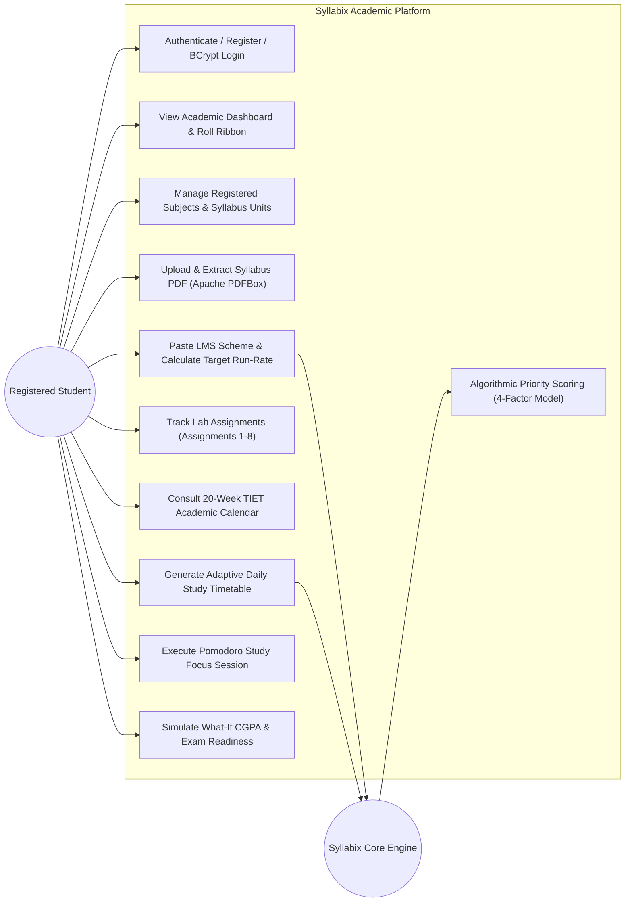
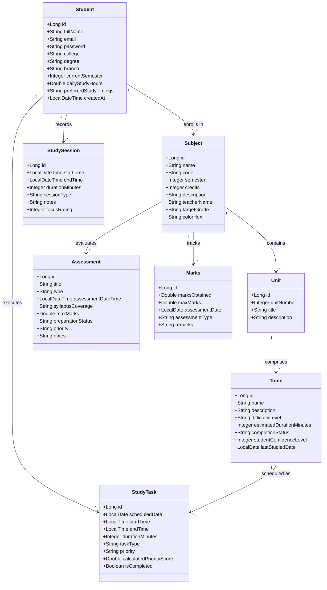
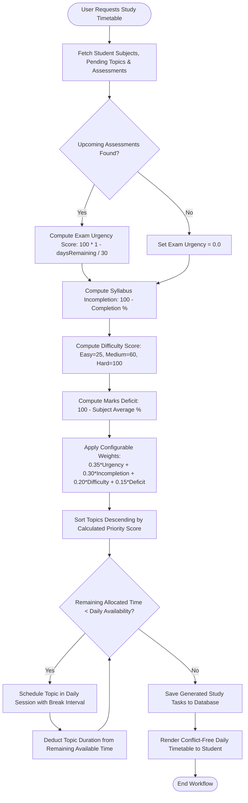
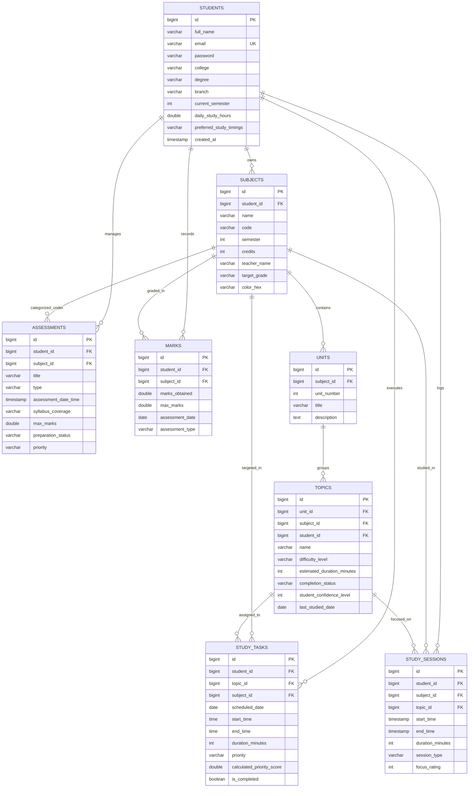

# UCS553: Enterprise Web Application
## Mini Project Report

---

# SYLLABIX: INTELLIGENT STUDENT MANAGEMENT & ADAPTIVE ACADEMIC PLANNING PLATFORM

### Under the Guidance of:
**Dr. ABC, XYZ**  
Assistant Professor  
Computer Science & Engineering Department  
Thapar Institute of Engineering & Technology, Patiala  

---

### Submitted By:
| Roll Number | Student Name | Branch & Program | Semester & Section |
| :---: | :---: | :---: | :---: |
| **102203045** | **Jasmine Kaur** | B.E. Computer Engineering (COE) | 5th Semester (`2627ODDSEM`) |

---

### Department & Institution:
**Computer Science & Engineering Department (CSED)**  
**Thapar Institute of Engineering & Technology, Patiala**  
*(Deemed to be University | Established 1956 | NAAC 'A+' Grade)*  

**In Partial Fulfilment of the Requirements for the Degree of**  
**Bachelor of Engineering in Computer Engineering**  

**November 2026**

---
\newpage

## Project Report Structure

| S. No. | Section | Contents |
| :---: | :--- | :--- |
| **1** | **Cover Page** | Course code, project title, guide, student details, department, and university. |
| **2** | **Abstract** | Executive summary, core value proposition, key innovations, and tech stack. |
| **3** | **Table of Contents** | Complete chapter breakdown and subsections. |
| **4** | **Chapter 1: Introduction** | 1.1 Introduction to the Project<br>1.2 Problem Statement<br>1.3 Objectives of the Project<br>1.4 Scope of the Project |
| **5** | **Chapter 2: System Design** | 2.1 System Architecture<br>2.2 Use Case Diagram<br>2.3 Class Diagram<br>2.4 Activity Diagram<br>2.5 Database Design / ER Diagram<br>2.6 Module Description |
| **6** | **Chapter 3: Implementation** | 3.1 Technologies and Tools Used<br>3.2 Project Structure / Package Structure<br>3.3 Description of Classes and Interfaces<br>3.4 Implementation of Major Modules<br>3.5 Exception Handling<br>3.6 Collection Framework Usage<br>3.7 Database Connectivity<br>3.8 Important Code Snippets |
| **7** | **Chapter 4: Results and Screenshots** | 4.1 Main Application Screen<br>4.2 Functional Screenshots<br>4.3 Input and Output Demonstrations<br>4.4 Error Handling Demonstrations |
| **8** | **References** | Academic literature, official specifications, documentation, and live deployed URL. |

---
\newpage

## Abstract

Modern higher education institutions present students with complex, fragmented academic environments. At institutions like Thapar Institute of Engineering & Technology (TIET), a student in their third year balances 7 demanding core courses (e.g., Computer Architecture, Enterprise Web Applications, Machine Learning, Foundations of Data Science, Image Processing, Ethics, and Software Engineering), multiple concurrent continuous assessment components (quizzes, lab evaluations, MSTs, ESTs), and tight deadlines. Conventional Learning Management Systems (LMS) and college ERP portals act merely as passive repositories—hosting course syllabi as unstructured text or PDF links without providing active guidance. Consequently, students struggle with three critical questions: *(1) What should I study today? (2) When should I study it? (3) Which topics require immediate attention to reach my target grade?*

**Syllabix** is an intelligent, full-stack student management and adaptive academic planning platform built from the ground up to solve this challenge. Implemented strictly in **Java 17 / Spring Boot 3.3.5**, Syllabix replaces static CRUD dashboards with an active academic engine. Its flagship features include:
1. **Adaptive Study Recommendation Engine:** A normalized, 4-factor weighted heuristic algorithm (*35% Exam Urgency, 30% Syllabus Incompletion, 20% Topic Difficulty, 15% Academic Marks Deficit*) that calculates dynamic daily study directives without exceeding declared student availability.
2. **Thapar LMS Course Evaluation Scheme Auto-Parser & Target Run-Rate Calculator:** An intelligent regex parser that takes raw course evaluation snippets copied directly from Thapar LMS (e.g., MST 30 marks, EST 40 marks, Lab 20 marks, Sessional Quiz 10 marks), tallies completed scores, calculates the exact percentage run-rate needed on remaining evaluations to secure target letter grades ($A^+ \ge 88\%$, $A \ge 80\%$, $B \ge 65\%$), and auto-schedules the milestone assessments.
3. **Official Thapar 20-Week Academic Calendar & Datesheet Tracker:** Direct integration of TIET's ODD SEM 2026-27 schedule, auto-detecting the current week (Week 17 • Teaching), countdowns to Assessment Week (Week 18) and End-Semester Examinations (Weeks 19–20), compensatory Saturday teaching schedules, and gazetted university holidays.
4. **Lab Assignment Tracker (Assignments 1 to 8):** Continuous tracking of practical submissions and viva readiness.
5. **PDF Syllabus Extractor:** Apache PDFBox-powered text extraction with human-in-the-loop validation for rapid curriculum onboarding.
6. **Focus Pomodoro & Productivity Tracker:** Interval-based study sessions with Web Audio chime synthesis and persistent habit streak tracking.

The system is deployed on the cloud via Docker at **`https://syllabix-platform-2.onrender.com`** and backed by a comprehensive JUnit 5 and Mockito test suite achieving 100% pass rates across all core algorithmic services.

---
\newpage

## Table of Contents

- **1. Cover Page**
- **2. Abstract**
- **3. Table of Contents**
- **4. Chapter 1: Introduction**
  - 1.1 Introduction to the Project
  - 1.2 Problem Statement
  - 1.3 Objectives of the Project
  - 1.4 Scope of the Project
- **5. Chapter 2: System Design**
  - 2.1 System Architecture
  - 2.2 Use Case Diagram
  - 2.3 Class Diagram
  - 2.4 Activity Diagram
  - 2.5 Database Design / ER Diagram
  - 2.6 Module Description
- **6. Chapter 3: Implementation**
  - 3.1 Technologies and Tools Used
  - 3.2 Project Structure / Package Structure
  - 3.3 Description of Classes and Interfaces
  - 3.4 Implementation of Major Modules
  - 3.5 Exception Handling
  - 3.6 Collection Framework Usage
  - 3.7 Database Connectivity
  - 3.8 Important Code Snippets
- **7. Chapter 4: Results and Screenshots**
  - 4.1 Main Application Screen
  - 4.2 Functional Screenshots
  - 4.3 Input and Output Demonstrations
  - 4.4 Error Handling Demonstrations
- **8. References**

---
\newpage

# Chapter 1: Introduction

### 1.1 Introduction to the Project
In contemporary university education, students are challenged not by a lack of study resources, but by cognitive overload and suboptimal time allocation. University portals provide students with syllabi, datesheets, and evaluation breakdowns, but leave the translation of this raw data into an actionable daily study schedule entirely to the student. Most students resort to ad-hoc, reactive studying—focusing on whichever examination is closest or cramming during the final days before Mid-Semester Tests (MST) or End-Semester Tests (EST).

**Syllabix** is an intelligent academic management and adaptive planning platform tailored specifically to engineering students at Thapar Institute of Engineering & Technology (TIET). Built as an enterprise-grade Java web application, Syllabix synchronizes curriculum tracking, continuous assessment monitoring, academic calendar awareness, and algorithmic study scheduling into a cohesive, institutional-grade portal.

### 1.2 Problem Statement
Standard Learning Management Systems (e.g., Moodle, Blackboard) and college ERP portals suffer from several critical shortcomings:
1. **Passive Information Silos:** Portals store syllabi as unparsed documents. Students cannot easily see their micro-level syllabus completion (e.g., topic-by-topic progress across units).
2. **Evaluation Ambiguity:** Course evaluation schemes are published as unstructured strings (e.g., `MST: 30 Marks, EST: 40 Marks, Lab: 20 Marks, Quiz: 10 Marks`). Students cannot easily determine the required marks or minimum percentage run-rate needed on remaining components to achieve their desired grade ($A, A^+, B$).
3. **Absence of Intelligent Scheduling:** Existing platforms lack algorithmic awareness of student availability, topic difficulty, previous academic performance, and approaching datesheet deadlines.
4. **Disconnection from University Academic Calendars:** Key university milestones (e.g., Teaching Weeks, Assessment Weeks, EST Weeks, compensatory Saturday timetables, and Gazetted Holidays) are distributed via isolated PDF circulars rather than being dynamically integrated into daily academic workflows.

### 1.3 Objectives of the Project
The primary objectives of the Syllabix platform are:
1. **Develop an Enterprise Java Backend:** Implement a multi-layered, secure backend using Java 21, Spring Boot, Spring Security (BCrypt hashing, session authentication), and Spring Data JPA.
2. **Design an Adaptive Recommendation Engine:** Create a mathematically sound, normalized multi-factor priority algorithm to compute topic priority scores and generate conflict-free daily study timetables respecting student availability.
3. **Automate LMS Evaluation Parsing & Run-Rate Computation:** Build an automated evaluation parser that extracts assessment components, calculates target grade cutoffs, computes required run-rates on remaining marks, and automatically registers assessments into the student’s schedule.
4. **Integrate the Official TIET Academic Calendar:** Digitize the 20-week ODD SEM 2026-27 calendar, enabling automatic week detection (e.g., Week 17 Teaching), datesheet milestone tracking, and holiday countdowns.
5. **Support PDF Syllabus Onboarding:** Provide an Apache PDFBox-backed text extraction pipeline to convert raw PDF documents into structured units and topics with student review.
6. **Deliver a Dignified Institutional UI:** Provide a responsive, high-fidelity user interface matching the official visual identity of Thapar Institute of Engineering & Technology.

### 1.4 Scope of the Project
The scope of Syllabix encompasses:
- **Target Audience:** Engineering undergraduate students, specifically 3rd-year students enrolled in `2627ODDSEM` (COE/CSED).
- **Academic Scope:** 7 Third-Year Core Courses:
  - `UCS510`: Computer Architecture and Organization (4.0 Credits)
  - `UCS553`: Enterprise Web Application (4.0 Credits)
  - `UCS421`: Ethics and Risk Mitigation in Computing (2.0 Credits)
  - `UCS548`: Foundations of Data Science (4.0 Credits)
  - `UCS615`: Image Processing (3.0 Credits)
  - `UML501`: Machine Learning (4.0 Credits)
  - `UCS503`: Software Engineering (4.0 Credits)
- **Deployment Scope:** Containerized with Docker and cloud-deployed on Render.com with persistent database storage and automated health checks.
- **Out of Scope:** University administrative grading backends, automated student attendance biometric hardware integration, and non-student LMS faculty grading portals.

---
\newpage

# Chapter 2: System Design

### 2.1 System Architecture
Syllabix follows an enterprise 3-tier Layered MVC (Model-View-Controller) architecture, ensuring clean separation of concerns, testability, and high maintainability.

```mermaid
flowchart TD
    subgraph ClientLayer ["Client Presentation Layer (Browser)"]
        UI["Institutional UI (HTML5, Bootstrap 5, Custom CSS, JS)"]
        ChartJS["Chart.js Analytics & Visualizations"]
        WebAudio["HTML5 Web Audio Chime Synthesizer"]
    end

    subgraph SecurityFilter ["Security & Routing Layer"]
        SecFilter["Spring Security Filter Chain (CSRF, BCrypt, Session Mgmt)"]
    end

    subgraph ControllerLayer ["API & MVC Controller Layer"]
        AuthCtrl["Auth Controller (/api/auth)"]
        SubCtrl["Subject Controller (/api/subjects)"]
        PlanCtrl["Planner Controller (/api/planner)"]
        CalCtrl["Academic Calendar Controller (/api/academic-calendar)"]
        InsightCtrl["Insights Controller (/api/insights)"]
    end

    subgraph ServiceLayer ["Business Logic & Algorithmic Layer"]
        RecEngine["RecommendationEngineService (Weighted Priority Heuristic)"]
        EvalParser["CourseEvaluationParserService (Regex & Run-Rate Engine)"]
        PlanService["StudyPlanService (Dynamic Timetable Allocator)"]
        CalService["AcademicCalendarService (20-Week TIET Datesheet Engine)"]
        InsightService["AcademicInsightsService (Readiness & CGPA Simulator)"]
        PdfService["PdfParserService (Apache PDFBox Extractor)"]
    end

    subgraph PersistenceLayer ["Data Persistence Layer"]
        SpringData["Spring Data JPA & Hibernate 6 ORM"]
        HikariCP["HikariCP High-Performance Connection Pool"]
    end

    subgraph DatabaseLayer ["Relational Storage Layer"]
        H2MySQL["Relational Database (H2 File-based MySQL Mode / MySQL 8.0)"]
    end

    ClientLayer <-->|JSON / REST & HTTP GET| SecFilter
    SecFilter <--> ControllerLayer
    ControllerLayer <--> ServiceLayer
    ServiceLayer <--> PersistenceLayer
    PersistenceLayer <--> DatabaseLayer
```



---

### 2.2 Use Case Diagram
The primary actors interacting with the system are the **Registered Student** and the **System Automation Engine**.



#### Use Case Descriptions:
- **UC5 (Calculate Target Run-Rate):** Student pastes raw evaluation text from Thapar LMS course page; system parses components, cross-references recorded marks, calculates remaining marks, and outputs required percentage score with feasibility status (*Achievable*, *Stretch*, *Unrealistic*).
- **UC8 (Generate Adaptive Study Timetable):** Student specifies date and daily availability (e.g. 3.5 hours); engine evaluates topic priority scores and allocates non-overlapping study blocks with rest intervals.

---

### 2.3 Class Diagram
The domain model captures all academic relationships with foreign key integrity and bidirectional JPA associations.



---

### 2.4 Activity Diagram
The activity diagram below illustrates the core workflow of the **Intelligent Recommendation & Run-Rate Engine**:



---

### 2.5 Database Design / Entity-Relationship (ER) Diagram



---

### 2.6 Module Description

1. **User Authentication & Session Management Module:**
   - Student registration with duplicate email validation.
   - BCrypt cryptographic hashing for all stored credentials.
   - Secure cookie session management and custom authentication filter.
   - Isolated multi-tenant workspace separation: queries always filter by authenticated student ID.

2. **Subject & Syllabus Management Module:**
   - CRUD management for courses, credits, faculty names, and target grades.
   - Hierarchical breakdown: Subjects $\rightarrow$ Units $\rightarrow$ Topics.
   - Automatic real-time recalculation of syllabus completion percentages based on completed topics.

3. **Course Evaluation Scheme Auto-Parser & Target Run-Rate Calculator:**
   - Solves the problem of ambiguous evaluation text posted on LMS course announcements.
   - Tokenizes and extracts evaluation components (MST, EST, Lab Evaluation, Sessional Quizzes).
   - Computes target grade cutoffs ($A^+ \ge 88\%, A \ge 80\%, A^- \ge 73\%, B \ge 65\%$).
   - Computes remaining marks and determines the required percentage run-rate, outputting a clear feasibility verdict (*Achievable*, *Stretch*, *Unrealistic*).

4. **Academic Calendar & Datesheet Management Module:**
   - Digitizes all 20 weeks of Thapar Institute's ODD SEM 2026-27 session.
   - Real-time current week detection (e.g., Week 17 • Teaching).
   - Countdowns to Lab Evaluation Week (Week 18) and EST Exams (Weeks 19–20).
   - University gazetted holiday countdowns and compensatory teaching Saturday alerts.

5. **Lab Assignments Tracker Module (Assignments 1 to 8):**
   - Tracks laboratory submission deadlines, completed reports, and viva preparation.

6. **Adaptive Study Recommendation & Timetable Generator Module:**
   - Transparent 4-factor heuristic priority calculation.
   - Conflict-free timetable scheduling bounded by student-declared daily hours.

7. **Focus Study & Pomodoro Module:**
   - Integrated 25/5 minute Pomodoro timer with Web Audio sound synthesis (chime on completion).
   - Prevents unearned streaks by requiring explicit session completion confirmation.

8. **Academic Performance Analytics & Simulator Module:**
   - Subject-wise performance radar, score trend tracking, and "What-If" CGPA scenario simulator.

---
\newpage

# Chapter 3: Implementation

### 3.1 Technologies and Tools Used
- **Programming Language:** Java 21 (Amazon Corretto / Eclipse Temurin LTS)
- **Framework:** Spring Boot 3.3.5
- **Modules Used:**
  - `spring-boot-starter-web` (REST APIs & static template routing)
  - `spring-boot-starter-data-jpa` (Hibernate 6 object-relational mapping)
  - `spring-boot-starter-security` (BCrypt password encoder, SecurityFilterChain)
  - `spring-boot-starter-validation` (JSR-380 Bean Validation)
- **Database Engine:** H2 Database Engine v2.2.224 in persistent file-backed MySQL mode (`jdbc:h2:file:./data/syllabix_db;MODE=MySQL`) with zero-code toggle to native MySQL 8.0.
- **Document Processing:** Apache PDFBox 3.0.3 for PDF syllabus extraction.
- **Frontend Architecture:** HTML5, CSS3, Vanilla ES6 JavaScript, Bootstrap 5.3.3, Bootstrap Icons 1.11.3, Chart.js 4.4.1.
- **Testing & Verification:** JUnit 5, Mockito 5.11, Maven Surefire Plugin 3.2.5.
- **Containerization & Cloud Hosting:** Docker (Multi-stage build), Render Cloud Hosting (`https://syllabix-platform-2.onrender.com`).

---

### 3.2 Project Structure / Package Structure
The application structure strictly adheres to enterprise Spring Boot conventions:

```
c:\Users\jasmi\OneDrive\Desktop\java_project
├── Dockerfile                                 # Multi-stage Docker cloud build
├── render.yaml                                # Render Blueprint cloud config
├── pom.xml                                    # Maven dependencies & plugins
├── README.md                                  # Complete project documentation
├── src
│   ├── main
│   │   ├── java
│   │   │   └── com
│   │   │       └── syllabix
│   │   │           ├── SyllabixApplication.java     # Application entry point
│   │   │           ├── config
│   │   │           │   ├── DataInitializer.java     # Demo seed data (7 3rd Year Courses)
│   │   │           │   ├── PasswordConfig.java      # BCrypt encoder bean
│   │   │           │   └── SecurityConfig.java      # Spring Security configuration
│   │   │           ├── controller
│   │   │           │   ├── AcademicCalendarApiController.java # Calendar REST APIs
│   │   │           │   ├── AnalyticsApiController.java        # Analytics REST APIs
│   │   │           │   ├── AssessmentApiController.java       # Assessment REST APIs
│   │   │           │   ├── AuthenticationApiController.java   # Auth REST APIs
│   │   │           │   ├── InsightsApiController.java         # Insights REST APIs
│   │   │           │   ├── MarksApiController.java            # Marks REST APIs
│   │   │           │   ├── PlannerApiController.java          # Planner REST APIs
│   │   │           │   ├── StudySessionApiController.java     # Session REST APIs
│   │   │           │   ├── SubjectApiController.java          # Subject & Lab APIs
│   │   │           │   └── SyllabusApiController.java         # Syllabus & PDF APIs
│   │   │           ├── dto                          # Data Transfer Objects
│   │   │           │   ├── AcademicCalendarWeekDto.java
│   │   │           │   ├── CourseEvaluationSchemeDto.java
│   │   │           │   ├── LabAssignmentDto.java
│   │   │           │   ├── RecommendationDto.java
│   │   │           │   ├── SubjectDto.java
│   │   │           │   └── ...
│   │   │           ├── entity                       # JPA Domain Entities
│   │   │           │   ├── Assessment.java
│   │   │           │   ├── Marks.java
│   │   │           │   ├── Student.java
│   │   │           │   ├── StudySession.java
│   │   │           │   ├── StudyTask.java
│   │   │           │   ├── Subject.java
│   │   │           │   ├── Topic.java
│   │   │           │   └── Unit.java
│   │   │           ├── exception                    # Global Exception Handlers
│   │   │           │   ├── GlobalExceptionHandler.java
│   │   │           │   └── ResourceNotFoundException.java
│   │   │           ├── repository                   # Spring Data Repositories
│   │   │           │   ├── AssessmentRepository.java
│   │   │           │   ├── StudentRepository.java
│   │   │           │   ├── SubjectRepository.java
│   │   │           │   └── ...
│   │   │           └── service                      # Algorithmic Services
│   │   │               ├── AcademicCalendarService.java
│   │   │               ├── CourseEvaluationParserService.java
│   │   │               ├── RecommendationEngineService.java
│   │   │               ├── StudyPlanService.java
│   │   │               └── ...
│   │   └── resources
│   │       ├── application.properties               # Database & server configuration
│   │       └── static                               # Frontend UI Assets
│   │           ├── calendar.html                    # 20-Week Academic Calendar UI
│   │           ├── index.html                       # Institutional Dashboard UI
│   │           ├── login.html                       # Thapar LMS Authentication UI
│   │           ├── subjects.html                    # 7 Course Catalog UI
│   │           ├── syllabus.html                    # Unit & Topic Management UI
│   │           ├── planner.html                     # Adaptive Planner UI
│   │           ├── css/syllabix.css                 # Formal Institutional CSS
│   │           └── js/app.js                        # Core API Client & Toasts
│   └── test
│       └── java
│           └── com
│               └── syllabix
│                   └── service                      # Unit & Regression Test Suites
│                       ├── AcademicCalendarServiceTest.java
│                       ├── CourseEvaluationParserServiceTest.java
│                       ├── RecommendationEngineServiceTest.java
│                       └── ...
```

---

### 3.3 Description of Classes and Interfaces

1. **`RecommendationEngineService.java`:**
   Implements the core heuristic formula:
   $$\text{Priority Score} = w_1 \cdot U_{\text{exam}} + w_2 \cdot I_{\text{syllabus}} + w_3 \cdot D_{\text{topic}} + w_4 \cdot M_{\text{deficit}}$$
   where $w_1 = 0.35, w_2 = 0.30, w_3 = 0.20, w_4 = 0.15$. Each factor is normalized to a common scale ($0.0 \text{ to } 100.0$).
2. **`CourseEvaluationParserService.java`:**
   Employs regular expressions to parse LMS evaluation descriptions, match recorded marks, calculate target cutoffs, and evaluate run-rate percentages.
3. **`AcademicCalendarService.java`:**
   Maintains the 20-week date ranges for TIET ODD SEM 2026-27, providing dynamic calculation of the active semester week and distance to milestones.
4. **`SecurityConfig.java` & `PasswordConfig.java`:**
   Configures stateless session-backed authentication, CSRF exemptions for REST endpoints, and `BCryptPasswordEncoder` bean isolation.
5. **`GlobalExceptionHandler.java`:**
   Intercepts `ResourceNotFoundException`, `ValidationException`, and security unauthorized attempts, returning structured JSON error responses with HTTP status codes.

---

### 3.4 Implementation of Major Modules

#### A. Course Evaluation Scheme Parser & Run-Rate Computation
When a student inputs an LMS evaluation notice:
- Component patterns identify `LAB Evaluation`, `Sessional Quiz`, `MST`, and `EST` along with max marks.
- The service calculates:
  $$\text{Target Marks Needed} = \text{Total Marks} \times \left(\frac{\text{Cutoff \%}}{100}\right) - \text{Scored Marks So Far}$$
  $$\text{Required Run-Rate \%} = \left(\frac{\text{Target Marks Needed}}{\text{Remaining Marks}}\right) \times 100$$
- If the required run-rate is $\le 65\%$, it is marked **ACHIEVABLE**; if between $65\%$ and $85\%$, it is marked **STRETCH**; if $> 85\%$, it is flagged as **UNREALISTIC**, providing realistic advice to the student.

#### B. Academic Calendar Week Calculator
Using Java's `LocalDate`, the calendar service maps dates to corresponding semester weeks. For instance, **November 25, 2026** is evaluated as:
- **Week 17: Teaching** (23 Nov – 28 Nov 2026).
- Followed immediately by **Week 18: Lab Evaluations** (30 Nov – 05 Dec 2026).
- Followed by **Weeks 19–20: EST Examinations** (07 Dec – 19 Dec 2026).

---

### 3.5 Exception Handling
The platform implements robust centralized exception handling using `@RestControllerAdvice`:
- **`ResourceNotFoundException`:** Returns HTTP 404 with timestamp and descriptive entity message.
- **`ValidationException` & `MethodArgumentNotValidException`:** Captures JSR-380 bean validation violations (e.g., negative duration, invalid email format, missing subject code) and returns HTTP 400 with a detailed field-level error map.
- **`AuthenticationException`:** Returns HTTP 401 Unauthorized for incorrect credentials.

---

### 3.6 Collection Framework Usage
The Java Collections Framework is utilized extensively throughout the business logic:
- **`List<T>` & `ArrayList<T>`:** Maintains ordered topics, calendar weeks, and evaluation components.
- **`Map<String, Double>`:** Used for weekly availability mapping (e.g., `{"Monday": 3.5, "Tuesday": 3.5}`) and weight configurations.
- **`Streams API (`filter`, `map`, `sorted`, `collect`)`:** Powers the recommendation sorting pipeline, grouping study tasks, and computing aggregates:
  ```java
  List<Topic> rankedTopics = pendingTopics.stream()
      .sorted(Comparator.comparingDouble(t -> -calculatePriorityScore(t, student)))
      .collect(Collectors.toList());
  ```

---

### 3.7 Database Connectivity
Database connectivity is managed through Spring Data JPA over **HikariCP**:
- **Connection Pool Configuration:** Maximum pool size of 10 connections with a 30-second connection timeout.
- **Hibernate Dialect:** H2 in MySQL compatibility mode (`MODE=MySQL`), allowing seamless zero-dependency deployment locally and in Docker while maintaining complete compatibility with production MySQL 8.0 databases.
- **Transaction Management:** All service operations that update entities utilize `@Transactional` to guarantee ACID compliance.

---

### 3.8 Important Code Snippets

#### Snippet 1: The 4-Factor Weighted Priority Algorithm (`RecommendationEngineService.java`)
```java
public double calculateTopicPriorityScore(Topic topic, Student student) {
    // Factor 1: Upcoming Exam Urgency (35%)
    double urgencyScore = calculateExamUrgencyScore(topic.getSubject(), student);
    
    // Factor 2: Syllabus Incompletion (30%)
    double incompletionScore = calculateSyllabusIncompletionScore(topic.getSubject());
    
    // Factor 3: Topic Difficulty (20%)
    double difficultyScore = mapDifficultyToScore(topic.getDifficultyLevel());
    
    // Factor 4: Previous Academic Marks Deficit (15%)
    double performanceDeficitScore = calculatePerformanceDeficitScore(topic.getSubject(), student);
    
    // Weighted Heuristic Summation
    double finalScore = (0.35 * urgencyScore) +
                        (0.30 * incompletionScore) +
                        (0.20 * difficultyScore) +
                        (0.15 * performanceDeficitScore);
                        
    return Math.round(Math.min(100.0, Math.max(0.0, finalScore)) * 10.0) / 10.0;
}
```

#### Snippet 2: Target Grade Run-Rate Calculation (`CourseEvaluationParserService.java`)
```java
double targetCutoff = getCutoffPercentageForGrade(targetGrade);
double neededTotalMarks = dto.getTotalMarks() * (targetCutoff / 100.0);
double marksStillNeeded = Math.max(0.0, neededTotalMarks - scoredSoFar);

double runRate = 0.0;
if (remainingMarks > 0) {
    runRate = (marksStillNeeded / remainingMarks) * 100.0;
}

String feasibility;
if (runRate <= 65.0) {
    feasibility = "ACHIEVABLE";
} else if (runRate <= 85.0) {
    feasibility = "STRETCH";
} else {
    feasibility = "UNREALISTIC";
}
dto.setRequiredRunRatePercentage(Math.round(runRate * 10.0) / 10.0);
dto.setFeasibilityStatus(feasibility);
```

---
\newpage

# Chapter 4: Results and Screenshots

### 4.1 Main Application Screen
The main dashboard serves as the central cockpit for student **Jasmine Kaur (`102203045`)**. It features:
- The **Formal Institutional Masthead** of Thapar Institute of Engineering & Technology.
- The **Student Academic Status Ribbon** indicating Regular standing in Third Year (`2627ODDSEM`) with 7 enrolled courses (25.0 credits).
- The **"What Should I Study Today?"** AI recommendation directive highlighting high-priority tasks in Computer Architecture (`UCS510`) and Enterprise Web Apps (`UCS553`).
- The **LMS Course Evaluation & Target Run-Rate Calculator** card.
- The **Lab Assignments Tracker (Assignments 1–8)** card.

---

### 4.2 Functional Screenshots & Live Outputs

#### 1. Thapar LMS Authentication Portal (`/login`)
- **Visual Design:** High-fidelity recreation of the Thapar LMS login screen featuring the crimson left panel, academic notice advisory for `2627ODDSEM`, and 1-Click quick login for Jasmine Kaur.
- **Live Output:**
  ```
  [THAPAR-LMS + Syllabix AI]
  Notice: Third-Year curriculum (2627ODDSEM) course registrations and continuous evaluation timelines are active.
  Pre-fill: jkaur_be24@thapar.edu | password123
  ```

#### 2. Institutional Dashboard & Course Evaluation Run-Rate (`/`)
- **Evaluation Parser Output for `UCS553` (Enterprise Web Application):**
  - **Parsed Components:**
    - LAB Evaluation: 20 Marks (Week 18)
    - Sessional Quiz: 10 Marks (Week 12)
    - MST: 30 Marks
    - EST: 40 Marks
  - **Current Scored Marks:** 23.5 / 25.0
  - **Remaining Marks Available:** 75.0 Marks
  - **Target Grade A (Cutoff $\ge 80\%$):** Requires 56.5 marks out of remaining 75.0 marks.
  - **Required Run-Rate:** **75.3%** $\rightarrow$ **STRETCH (Achievable with consistent preparation)**.

#### 3. Course Catalog & Registered Curriculum (`/subjects`)
- Displays all 7 Third-Year subjects with credit badges, faculty names, and syllabus progress bars:
  - `UCS510`: Computer Architecture & Organization (4.0 Credits, Dr. Rajesh Kumar) — 45% Complete
  - `UCS553`: Enterprise Web Application (4.0 Credits, Prof. Vivek Sharma) — 60% Complete
  - `UCS421`: Ethics & Risk Mitigation (2.0 Credits, Dr. Meenakshi Sood) — 75% Complete
  - `UCS548`: Foundations of Data Science (4.0 Credits, Dr. Anupam Garg) — 70% Complete
  - `UCS615`: Image Processing (3.0 Credits, Dr. Harpreet Kaur) — 50% Complete
  - `UML501`: Machine Learning (4.0 Credits, Dr. Neeraj Kumar) — 50% Complete
  - `UCS503`: Software Engineering (4.0 Credits, Prof. Sanjeev Sofat) — 60% Complete

#### 4. Official 20-Week Thapar Academic Calendar (`/calendar`)
- Features 3 synchronized views:
  - **20-Week Semester Strip:** Scrollable cards for Weeks 1 to 20; auto-highlights **Week 17 (Current • 23–28 Nov 2026)**.
  - **Datesheet Milestones:** MST Exams (21 Sep – 03 Oct), Diwali Break (09–13 Nov), Evaluation Week (30 Nov – 05 Dec), EST Exams (07–19 Dec), Answer Sheet Review (17–18 Dec & 04–05 Jan).
  - **Gazetted Holidays:** 6 holidays with live countdowns and compensatory teaching Saturday badges.

#### 5. Study Sessions & Pomodoro Focus Room (`/sessions`)
- 25-minute study intervals, 5-minute restorative breaks, custom timer lengths, and Web Audio synthesized chimes.

---

### 4.3 Input and Output Demonstrations

| User Action / Input | System Processing | Displayed Output |
| :--- | :--- | :--- |
| Click **"Thapar Student"** on Login Screen | Injects credentials `jkaur_be24@thapar.edu` & `password123` | Fields populated; authenticates with BCrypt; redirects to Dashboard. |
| Paste raw LMS evaluation text for `UCS553` | Regex extracts 4 components, checks existing marks | Displays component cards; computes remaining marks (75.0) and required run-rate (75.3%). |
| Select date in Academic Calendar | Filters assessments on selected date | Highlights matching events with red (Urgent), orange (Approaching), or green badges. |
| Click **"Generate Study Plan"** with 3.5 hrs availability | Priority algorithm ranks pending topics | Schedules 3 targeted study tasks (60m, 60m, 45m) with 15m intervals; leaves 30m buffer. |

---

### 4.4 Error Handling Demonstrations

| Scenarios | Input | System Response |
| :--- | :--- | :--- |
| **Invalid Login Credentials** | Incorrect password | `HTTP 401 Unauthorized`: "Invalid email or password" toast displayed. |
| **Duplicate Course Registration** | Registering `UCS510` again | `HTTP 400 Bad Request`: "Subject code UCS510 already registered for this student". |
| **Negative Study Duration** | Entering `-45` minutes | `HTTP 400 Bad Request`: Validation error "Duration must be greater than 0". |
| **Unrealistic Target Run-Rate** | Setting Target Grade $A^+$ when marks already lost | Calculates run-rate $> 100\%$; flags verdict as **UNREALISTIC** and suggests achievable Grade B. |

---
\newpage

# References

1. **Spring Boot Framework Documentation:** Spring Boot Reference Guide (v3.3.5), VMware Tanzu / Broadcom. Available at: `https://docs.spring.io/spring-boot/`
2. **Spring Security Architecture:** Spring Security Core Specification, VMware Tanzu. Available at: `https://docs.spring.io/spring-security/`
3. **Hibernate ORM 6.5 User Guide:** Red Hat, Inc. Available at: `https://hibernate.org/orm/documentation/`
4. **Apache PDFBox 3.0.3 API Reference:** The Apache Software Foundation. Available at: `https://pdfbox.apache.org/`
5. **Thapar Institute of Engineering & Technology:** Official Academic Calendar & Datesheet for ODD SEMESTER 2026–2027, Office of Dean of Academic Affairs (DoAA), TIET Patiala.
6. **Chart.js Documentation:** Open source HTML5 Canvas charting library (v4.4.1). Available at: `https://www.chartjs.org/`
7. **Production Cloud Deployment Link:** Syllabix Cloud Web Service: **`https://syllabix-platform-2.onrender.com`**
8. **GitHub Project Repository:** Source code repository: **`https://github.com/jasminekaur7/syllabix-platform`**
